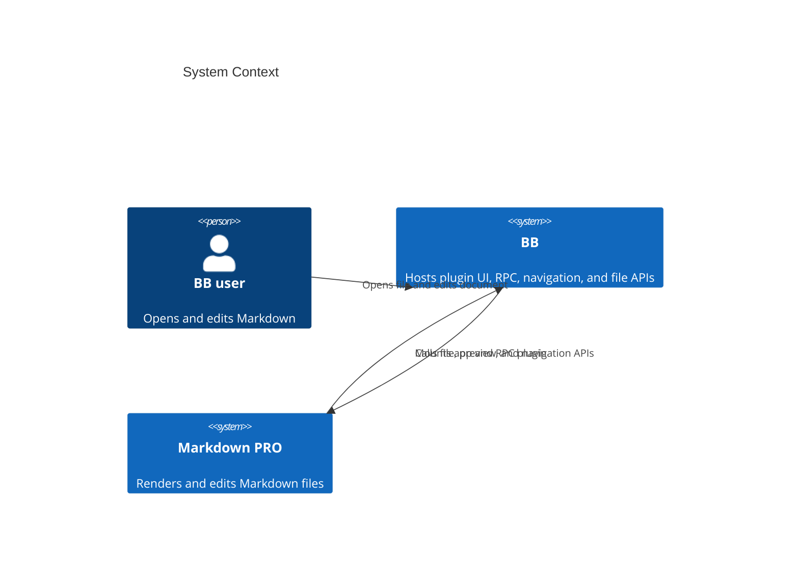
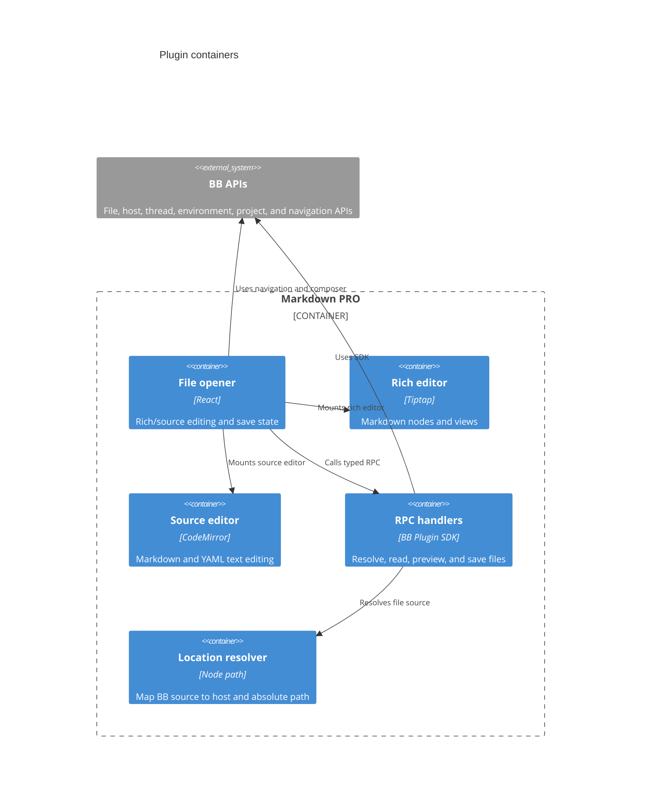
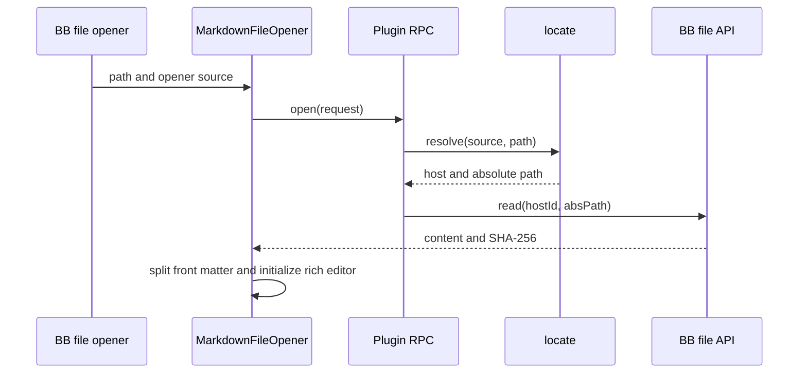
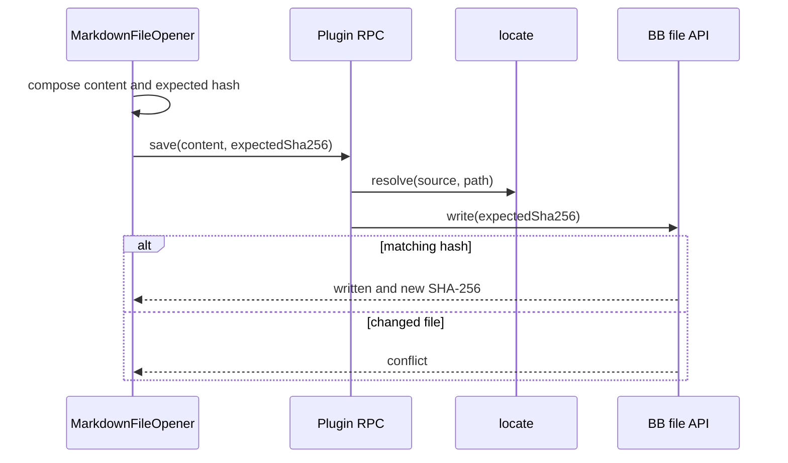
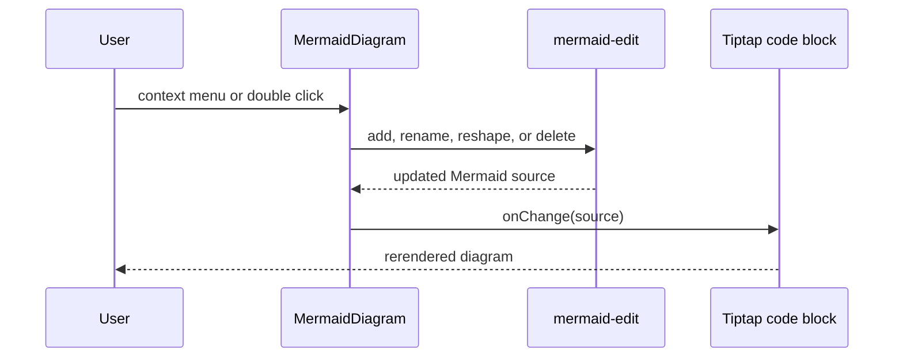

# Architecture

TL;DR: BB mounts a React file opener and a server plugin; the opener delegates file I/O to server RPC and composes CodeMirror, Tiptap, and Markdown-specific node views.

## System Context

BB supplies the app/server entry points declared in the package manifest; the plugin’s server registers its RPC contract (`package.json:4-12`, `server.ts:65-78`).

## Containers

The React opener imports the rich/source editors and calls RPC (`app.tsx:7-22`, `app.tsx:193-212`). The server handler delegates source resolution to `locate` and file operations to BB SDK methods (`server.ts:77-123`, `locate.ts:91-132`).

## Building Blocks

- [Markdown editing](editor.md) — file opener, Tiptap and CodeMirror editor surfaces, and tab menu.
- [Markdown file access](file-access.md) — RPC contract, source routing, read and conditional save.
- [Markdown rendering and diagram editing](rendering.md) — custom Markdown nodes, code blocks, and diagrams.

## Key Flows

### Open a Markdown file

Evidence: opener request and load (`app.tsx:193-212`, `app.tsx:270-281`), RPC resolution and read (`server.ts:77-95`).

### Save edited content

Evidence: composition and call (`app.tsx:314-352`), compare-and-swap write (`server.ts:114-122`).

### Edit a Mermaid flowchart

Evidence: menu operation handlers and callback (`rich.tsx:120-185`), source update (`rich.tsx:239-249`), edit transforms (`mermaid-edit.ts:57-102`, `mermaid-edit.ts:121-161`).

## Invariants

- File operations use a resolved host id and absolute path; source resolution does not choose another machine as fallback (`locate.ts:1-3`, `locate.ts:91-132`).
- Relative workspace paths are constrained under their root (`locate.ts:48-56`, `locate.ts:99-115`).
- The app preserves loaded source bytes when the rich document remains clean (`app.tsx:225-244`).
- Saves include the loaded hash and expose conflict instead of silently overwriting a changed file (`app.tsx:322-331`, `server.ts:114-122`).
- Markdown is the source representation for rich node edits (`rich.tsx:464-508`, `mermaid-edit.ts:1-2`).

## Cross-cutting concerns

**Errors:** RPC open localizes file-not-found and unavailable-machine errors; save failures distinguish conflict, missing file, and other error state (`server.ts:53-63`, `app.tsx:327-349`). See [file access](file-access.md).

**Internationalization:** UI locale derives from the document language and selects English or Russian strings (`i18n.ts:363-377`).

**Asset access:** The opener requests a temporary file preview base and rewrites only relative image paths inside the configured root (`server.ts:108-112`, `app.tsx:289-312`).

<!-- lane-pilot:backlinks -->
## Referenced by

- [Markdown PRO overview](overview.md)
